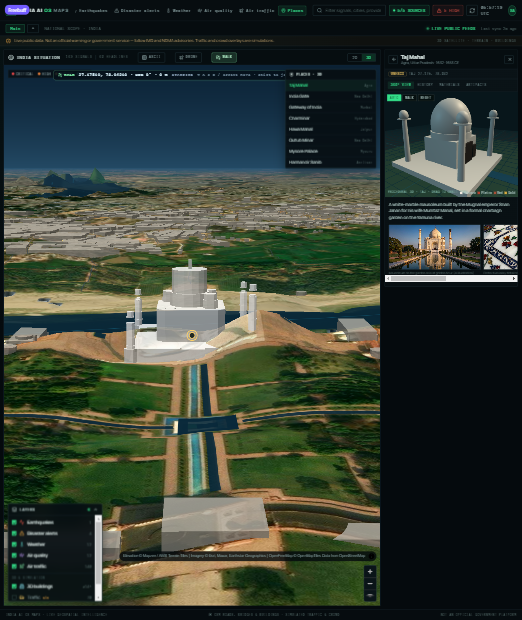

# PROJECT INDIA AI OS MAPS

**Live India-first geospatial intelligence workspace** — real public feeds, satellite 3D terrain, provenance on every record.


## 1. What this is

A working intelligence dashboard for India: a 3D satellite map of the country with live overlays, a real-time signal rail, a live headline wire, a grounded analyst and per-connector health.

Everything on screen comes from a public feed at request time. There is no seed data, no simulated marker and no placeholder metric.

## 2. Live sources

| Feed | Provider | Licence / terms | Refresh | Records |
|---|---|---|---|---|
| Earthquakes | U.S. Geological Survey | Public domain (US Government) | 2 min | M2.5+ events inside the India bbox |
| Disaster alerts | GDACS / UN OCHA | GDACS public alert feed, attribution required | 10 min | India-filtered hazard alerts |
| Weather | Open-Meteo | CC BY 4.0 | 10 min | Current conditions, 12 metros |
| Air quality | Open-Meteo (CAMS) | CC BY 4.0 | 10 min | US AQI, PM2.5, PM10, 12 metros |
| Air traffic | OpenSky Network | Non-commercial research use | 90 s | Aircraft state vectors over India |
| News | Google News India, Times of India RSS | Headlines and links only | 5 min | 60 latest headlines |

Basemap: Esri World Imagery tiles with AWS Terrain Tiles (Mapzen terrarium) for 3D relief and hillshade.

No API key is required for any of these. Feeds that do require credentials (IMD, NDMA SACHET, data.gov.in, BhuvAN) are described in `docs/04-data-connectors.md` and can be added as new adapters.

Headlines arrive in English and in eight Indian languages (Hindi, Tamil, Telugu, Bengali, Malayalam, Kannada, Gujarati, and English), each item tagged with its language so the rail can filter by it. Feeds: Google News India, Times of India, BBC Hindi/Telugu/Gujarati, Aaj Tak, News18 Tamil/Malayalam/Kannada, ABP Ananda. Headline and link only.

## 3. Architecture

```text
USGS · GDACS · Open-Meteo · OpenSky · News RSS
                |
                v
  FastAPI connectors (backend/app/sources)
  validate -> normalise -> provenance -> severity
                |
                v
  In-memory snapshot + per-source health (120 s refresh)
                |
                v
  React + MapLibre GL (satellite, terrain, live markers, signal rail)
```

Each source runs independently: one failing feed marks itself degraded in **Source health** and never blocks the rest of the dashboard.

## 4. Requirements

- Windows 11/10, macOS or Linux
- Python 3.11+
- Node.js 20+ and npm 10+
- Internet access for feeds, map tiles and packages

## 5. Start it

```powershell
Set-ExecutionPolicy -Scope Process Bypass
.\scripts\setup.ps1
.\scripts\dev.ps1
```

- Dashboard: `http://127.0.0.1:5173`
- API: `http://127.0.0.1:8000` · docs at `/docs`

Backend and frontend by hand:

```powershell
py -3 -m venv .venv
.\.venv\Scripts\Activate.ps1
pip install -r requirements.txt
uvicorn app.main:app --app-dir backend --reload --host 127.0.0.1 --port 8000
```

```powershell
cd frontend
npm install
npm run dev
```

Full check (dependencies, API tests, production build):

```powershell
.\scripts\build-all.ps1
```

## 6. API

| Method | Path | Purpose |
|---|---|---|
| GET | `/health` | Service status, source health counters, signal count |
| GET | `/api/v1/snapshot` | Full snapshot: signals, news, counts, source status |
| GET | `/api/v1/signals?layer=&severity=&limit=` | Filtered signals (`earthquake`, `alert`, `weather`, `air`, `flight`) |
| GET | `/api/v1/news?limit=` | Latest headlines |
| GET | `/api/v1/status` | Per-connector health, licence and cadence |
| POST | `/api/v1/refresh` | Force a refresh of every connector |
| POST | `/api/v1/analyst` | Deterministic analyst grounded in the current snapshot |

Signal record:

```json
{
  "id": "eq-us6000ud3i",
  "layer": "earthquake",
  "title": "M5.3 earthquake — 67 km WNW of Mangan, India",
  "severity": "high",
  "lat": 27.8328, "lng": 87.9467,
  "place": "67 km WNW of Mangan, India",
  "time": "2026-11-24T01:32:42+00:00",
  "provider": "U.S. Geological Survey",
  "source": "Earthquakes",
  "url": "https://earthquake.usgs.gov/earthquakes/eventpage/us6000ud3i",
  "detail": "Depth 0.0 km · 39 felt reports",
  "metrics": { "magnitude": 5.3, "depth_km": 0.0 }
}
```

`provider`, `time` and `url` are mandatory provenance fields; the UI shows them for every selected record.

`GET /api/v1/towers?west=&south=&east=&north=` returns communication towers in a bounding box (GeoJSON, cached for 15 minutes, Overpass-backed).

`GET /api/v1/city-model?west=&south=&east=&north=` returns the buildings, streets and water bodies used by the city page's 3D scene, parsed from the OpenStreetMap map API and cached for 30 minutes.

## 7. 3D map, ASCII locator and landmarks

**3D map.** The basemap is Esri satellite imagery over AWS terrain, so the camera can be tilted, rotated and pitched to any angle. Real building extrusions come from OpenFreeMap vector tiles (`building` layer with `render_height`) from zoom 13.6, with non-3D buildings filtered out. Buildings keep the colour mapped in OSM where it exists and otherwise use concrete-to-glass material tones sorted by height, drawn at 82% opacity so the satellite imagery still reads underneath.

**City view.** Clicking a city or town label (`city`/`town` places from the vector tiles) opens a full-screen page that builds that place's centre as a real 3D scene in Three.js, from scratch: every OSM building footprint is extruded to its tagged `height` or `building:levels`, capped with a roof, and painted by building class (residential, commercial, industrial, civic, education, health, religious, unmapped). Streets become road ribbons by class, water polygons are drawn flat, and a metric grid replaces the basemap. The satellite view is shown only while the model loads, then it is removed, so nothing of the 2D map remains behind the 3D city. Drag to look, `W A S D` to move, `Q`/`E` to turn, `R`/`F` to climb, wheel to close in, and the on-screen pad does the same. Clicking a building opens the city scan panel with its name, sector and height, flagging heights that OSM does not tag.

**Drone camera.** The `DRONE` button drops the camera to ~15.2 zoom at 68° pitch over the focused place and orbits it through a full 360°, pausing while you drag, scroll or zoom and resuming after three seconds. The HUD shows `ALT` (zoom) and `BRG` (bearing) with manual rotate (◀ ▶), climb/descend (▲ ▼) and an ORBIT toggle for hands-on control.

**ASCII projection.** The `ASCII` button renders the current map view as a character grid sampled from the live canvas. Clicking any cell un-projects that pixel to WGS84 coordinates, drops a locator pin, and lists the nearest landmarks and live signals within range.

**Traffic and crowd simulators.** Layer-drawer toggles for `Traffic sim` and `Crowd sim` animate vehicles and pulsing crowd density around the focused place. These are simulations, labelled as such in the UI and in the status strip — not measured traffic or footfall.

**Landmark reconstruction.** Eight Indian landmarks (Taj Mahal, India Gate, Gateway of India, Charminar, Hawa Mahal, Qutub Minar, Mysore Palace, Harmandir Sahib) are pinned on the map. Opening one replaces the right rail with a landmark panel:

- **360° VIEW** — a Three.js procedural reconstruction with orbit, auto-rotate and a low `WALK` camera pass, plus bundled imagery.
- **HISTORY** — summary, build dates, architect and historical notes.
- **MATERIALS** — stone, inlay and cladding with colour swatches, plus design concepts.
- **ARTIFACTS** — architectural features, cenotaphs, screens, gilding and related artifacts.

The 3D models are procedural interpretations built from primitives, not survey-grade or photogrammetric models. The Taj Mahal imagery in `frontend/public/landmarks/` is AI-generated illustration and is captioned as such.


## 8. Roads, walk mode and aircraft

**Places of interest.** The OSM `poi` layer is drawn from zoom 13 as coloured category dots — food and drink, lodging, shops, green space and beaches, culture and worship, transport and fuel, health — with names labelled from zoom 14.4. Toggle `Places & POIs` in the layer drawer. Names and categories come from OSM; no photographs are attached to them, because the tile schema carries no images.

**Forests and mountains.** Woodland and forest polygons are extruded as a low canopy mass instead of flat green fill, and named peaks carry their surveyed elevation from the `mountain_peak` layer. Hillshade and terrain remain underneath.

**Aircraft tracks.** Selecting a flight eases the camera out to ~9.5 zoom so the aircraft and its projected track are both in frame, and draws a dashed ray along its reported true track (length scaled from ground speed, capped at 180 km). This is a heading projection from the live position — OpenSky publishes no filed route or destination, so no destination is invented.

**Building sanity.** Extrusions ignore elevated `render_min_height` bases, which used to draw floating slabs around complexes like the Taj Mahal, and clamp implausible heights to 320 m. The Taj complex now reads as its mausoleum, plinth and four minarets rather than a heap.

**Street network.** Roads, bridges and tunnels come from the same OpenFreeMap vector tiles, not from the satellite picture: motorways, trunk roads, primary, secondary and tertiary roads carry width and colour ramps by class, local streets appear from zoom 13, railway lines are dashed, and tunnels are drawn dark and dashed beneath the road casing. Bridges and flyovers (`brunnel=bridge`) get a bright deck over an offset shadow so they read as elevated — the elevation is a cartographic effect on a real bridge line, not a measured deck height.

**Water and airports.** Lakes and river polygons fill over the imagery, waterways draw as lines, and airport runways and taxiways come from the `aeroway` layer.

**Dams.** Ten major Indian dams and barrages (Tehri, Bhakra, Idukki, Sardar Sarovar, Nagarjuna Sagar, Koyna, Rihand, Ukai, Hirakud, Mettur) are plotted from a curated public dataset in `frontend/src/infrastructure.ts`. Click a marker for river, type, height and year. Coordinates are rounded to about a kilometre.

**Terrain.** Exaggeration eases from 1.3 at country scale down to 0.85 from zoom 12, because the elevation DEM is roughly 90 m per cell — strong exaggeration at street zoom is what lifts road casings and building bases off the ground and bends them across slopes.

**Hologram scan.** Clicking anywhere on the map opens a hologram card listing what the style is actually drawing under that pixel: building height and class, road class with bridge/tunnel and lane counts, water, airport surface, railway, dam, landmark, aircraft or tower, plus the exact coordinate. Where nothing is mapped it says so rather than inventing an object.

**Interiors.** The landmark panel's `INSIDE` button swaps the exterior model for an explorable interior: an octagonal crypt with jali screens and cenotaph (Taj Mahal), a memorial colonnade with the Amar Jawan flame (India Gate), a colonnade courtyard (Qutub Minar), a durbar hall (Mysore Palace), a stair shaft (minaret) and a sanctum under a gold canopy (Harmandir Sahib). WASD walks at eye height, drag looks around, Shift moves faster. These are built from published descriptions of the spaces — not from photographs, and not photogrammetry.

**Network towers.** Communication towers are queried live from OpenStreetMap through Overpass and proxied by the API at `/api/v1/towers` (Overpass sends no CORS headers, so the browser cannot call it directly). Clicking a tower draws expanding coverage rings across the map — an indicative visualisation, not measured signal strength. If every Overpass mirror is unreachable the layer stays empty instead of showing invented sites.

**Walk mode.** The `WALK` button drops the camera to street level (~17.6 zoom, 78° pitch) at the focused place. `W`/`A`/`S`/`D` or the arrow keys move at 1.5 m/s, `Shift` jogs at 6 m/s, drag turns the view. The HUD shows position, heading, distance travelled and whether you are moving. You are walking over the real satellite imagery and the real OSM building extrusions — nothing is generated to fill the gaps, so you see what the tiles contain and nothing inside the buildings.

**Aircraft.** Live OpenSky positions now render as airliner silhouettes instead of dots: each is rotated to its reported true track, and painted with the livery of the operator derived from the ICAO callsign prefix (Air India, IndiGo, SpiceJet, Air India Express, Akasa, and 15 international carriers, in `frontend/src/airlines.ts`). Selecting a flight opens a procedural 3D narrowbody in that livery with altitude, speed and heading. OpenSky's public state vectors carry no airframe type or registration, so the model is representative, not the exact airframe.



## 9. Hosting

The UI is a static single-page app; the API is a Python service. They are deployed separately.

**API** — run it on any Python host (Render, Fly.io, Railway, a VPS) with:

```bash
uvicorn app.main:app --host 0.0.0.0 --port 8000
```

**UI on GitHub Pages** — push to `main`; `.github/workflows/deploy.yml` tests the API, builds the UI and publishes `frontend/dist`.

1. Repository → Settings → Pages → Source: **GitHub Actions**.
2. Repository → Settings → Secrets and variables → Actions → **Variables** → add `VITE_API_URL` set to your API origin (for example `https://india-api.example.com`).
3. Push, then open `https://<account>.github.io/<repository>/`.

A local build against a deployed API:

```powershell
cd frontend
$env:VITE_API_URL="https://your-api.example.com"; npm run build
```

Pages cannot execute Python, so a Pages-only deployment shows the UI shell with an API-unavailable banner until `VITE_API_URL` points at a reachable API.

## 10. Honesty and limits

- Not an official government service. Follow IMD and NDMA for warnings.
- Feeds provide observations and official alerts — not forecasts. No predictive model is included.
- The analyst is deterministic and grounded: it composes text from the current snapshot, cites records, and uses no language model.
- The 3D landmark models are procedural interpretations, not measured or photogrammetric reconstructions.
- City view footprints, street centrelines and tagged heights are real OSM data. Buildings with no `height`/`building:levels` tag get an estimated height from footprint size, and the city scan panel marks those as estimated.
- Nothing here reconstructs objects photogrammetrically from satellite pixels. Buildings, roads, bridges and dams are vector data (OSM/OpenFreeMap and a curated dam list); anything not in that data is simply absent.
- There are no interiors beyond the eight procedural landmark models, and no underground pipelines or utility networks — that data is not published openly for India, so none is invented.
- Bridge deck elevation is a cartographic shadow effect; dam coordinates are rounded to roughly 1 km; dam heights are published maximum structure heights.
- Aircraft livery is inferred from the callsign prefix and the 3D airframe is a generic narrowbody; OpenSky does not provide type or registration in the public feed.
- Landmark interiors are interpretive models built from written descriptions; they are not scans and contain no furniture or artwork data.
- Tower coverage rings are a schematic animation, not a radio propagation model. Tower positions come from OSM and are only as complete as OSM's coverage.
- POIs come from OSM and carry no imagery; there is no photo source in the tile schema used here.
- Aircraft "destination" is not available from OpenSky's public state vectors; the dashed ray is the current heading, not a route.
- Distant building detail is only as complete as OSM: where a footprint is missing, nothing is invented.
- Traffic and crowd overlays are simulations, not observed vehicle counts or footfall.
- Bundled landmark imagery is AI-generated illustration, captioned in the interface.
- No person-level tracking, no face recognition, no watchlists, no surveillance workflows.
- Every source's licence and refresh cadence is visible in the UI and `/api/v1/status`.

Product blueprint, roadmap, connector plan and governance rules live in `docs/`.
