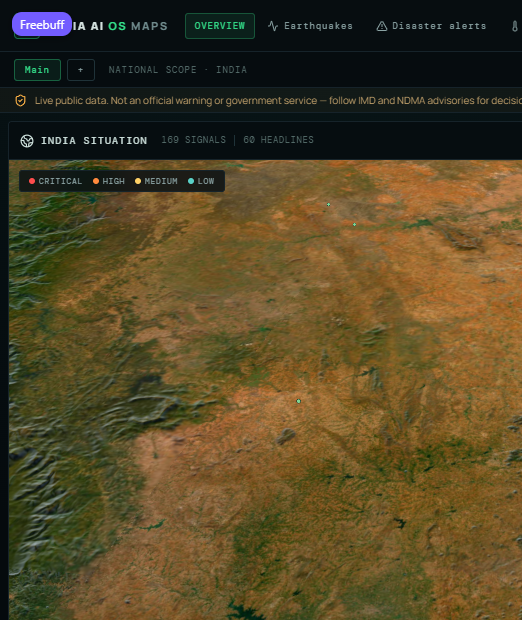
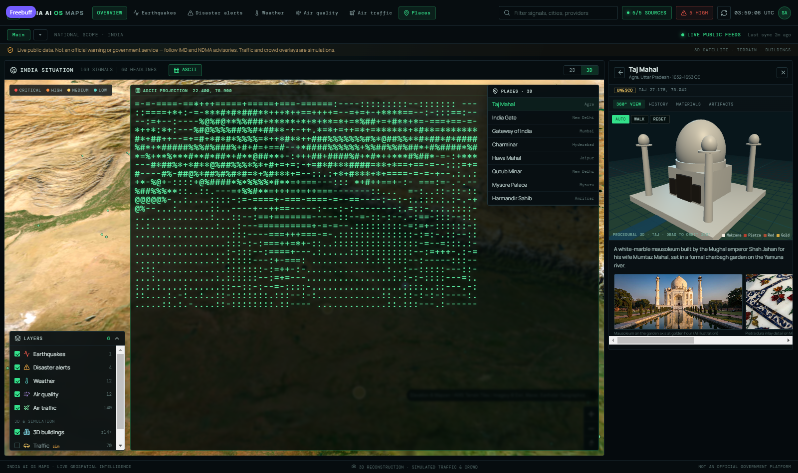

# PROJECT INDIA AI OS MAPS

**Live India-first geospatial intelligence workspace** — real public feeds, satellite 3D terrain, provenance on every record.



## 1. What this is

A working intelligence dashboard for India: a 3D satellite map of the country with live overlays, a real-time signal rail, a live headline wire, a grounded analyst and per-connector health.

Everything on screen comes from a public feed at request time. There is no seed data, no simulated marker and no placeholder metric.

## 2. Live sources

| Feed | Provider | Licence / terms | Refresh | Records |
|---|---|---|---|---|
| Earthquakes | U.S. Geological Survey | Public domain (US Government) | 2 min | M2.5+ events inside the India bbox |
| Disaster alerts | GDACS / UN OCHA | GDACS public alert feed, attribution required | 10 min | India-filtered hazard alerts |
| Weather | Open-Meteo | CC BY 4.0 | 10 min | Current conditions, 12 metros |
| Air quality | Open-Meteo (CAMS) | CC BY 4.0 | 10 min | US AQI, PM2.5, PM10, 12 metros |
| Air traffic | OpenSky Network | Non-commercial research use | 90 s | Aircraft state vectors over India |
| News | Google News India, Times of India RSS | Headlines and links only | 5 min | 60 latest headlines |

Basemap: Esri World Imagery tiles with AWS Terrain Tiles (Mapzen terrarium) for 3D relief and hillshade.

No API key is required for any of these. Feeds that do require credentials (IMD, NDMA SACHET, data.gov.in, BhuvAN) are described in `docs/04-data-connectors.md` and can be added as new adapters.

## 3. Architecture

```text
USGS · GDACS · Open-Meteo · OpenSky · News RSS
                |
                v
  FastAPI connectors (backend/app/sources)
  validate -> normalise -> provenance -> severity
                |
                v
  In-memory snapshot + per-source health (120 s refresh)
                |
                v
  React + MapLibre GL (satellite, terrain, live markers, signal rail)
```

Each source runs independently: one failing feed marks itself degraded in **Source health** and never blocks the rest of the dashboard.

## 4. Requirements

- Windows 11/10, macOS or Linux
- Python 3.11+
- Node.js 20+ and npm 10+
- Internet access for feeds, map tiles and packages

## 5. Start it

```powershell
Set-ExecutionPolicy -Scope Process Bypass
.\scripts\setup.ps1
.\scripts\dev.ps1
```

- Dashboard: `http://127.0.0.1:5173`
- API: `http://127.0.0.1:8000` · docs at `/docs`

Backend and frontend by hand:

```powershell
py -3 -m venv .venv
.\.venv\Scripts\Activate.ps1
pip install -r requirements.txt
uvicorn app.main:app --app-dir backend --reload --host 127.0.0.1 --port 8000
```

```powershell
cd frontend
npm install
npm run dev
```

Full check (dependencies, API tests, production build):

```powershell
.\scripts\build-all.ps1
```

## 6. API

| Method | Path | Purpose |
|---|---|---|
| GET | `/health` | Service status, source health counters, signal count |
| GET | `/api/v1/snapshot` | Full snapshot: signals, news, counts, source status |
| GET | `/api/v1/signals?layer=&severity=&limit=` | Filtered signals (`earthquake`, `alert`, `weather`, `air`, `flight`) |
| GET | `/api/v1/news?limit=` | Latest headlines |
| GET | `/api/v1/status` | Per-connector health, licence and cadence |
| POST | `/api/v1/refresh` | Force a refresh of every connector |
| POST | `/api/v1/analyst` | Deterministic analyst grounded in the current snapshot |

Signal record:

```json
{
  "id": "eq-us6000ud3i",
  "layer": "earthquake",
  "title": "M5.3 earthquake — 67 km WNW of Mangan, India",
  "severity": "high",
  "lat": 27.8328, "lng": 87.9467,
  "place": "67 km WNW of Mangan, India",
  "time": "2026-11-24T01:32:42+00:00",
  "provider": "U.S. Geological Survey",
  "source": "Earthquakes",
  "url": "https://earthquake.usgs.gov/earthquakes/eventpage/us6000ud3i",
  "detail": "Depth 0.0 km · 39 felt reports",
  "metrics": { "magnitude": 5.3, "depth_km": 0.0 }
}
```

`provider`, `time` and `url` are mandatory provenance fields; the UI shows them for every selected record.

## 7. 3D map, ASCII locator and landmarks

**3D map.** The basemap is Esri satellite imagery over AWS terrain, so the camera can be tilted, rotated and pitched to any angle. Real building extrusions come from OpenFreeMap vector tiles (`building` layer with `render_height`) and appear from zoom 14, coloured by height over the imagery.

**ASCII projection.** The `ASCII` button renders the current map view as a character grid sampled from the live canvas. Clicking any cell un-projects that pixel to WGS84 coordinates, drops a locator pin, and lists the nearest landmarks and live signals within range.

**Traffic and crowd simulators.** Layer-drawer toggles for `Traffic sim` and `Crowd sim` animate vehicles and pulsing crowd density around the focused place. These are simulations, labelled as such in the UI and in the status strip — not measured traffic or footfall.

**Landmark reconstruction.** Eight Indian landmarks (Taj Mahal, India Gate, Gateway of India, Charminar, Hawa Mahal, Qutub Minar, Mysore Palace, Harmandir Sahib) are pinned on the map. Opening one replaces the right rail with a landmark panel:

- **360° VIEW** — a Three.js procedural reconstruction with orbit, auto-rotate and a low `WALK` camera pass, plus bundled imagery.
- **HISTORY** — summary, build dates, architect and historical notes.
- **MATERIALS** — stone, inlay and cladding with colour swatches, plus design concepts.
- **ARTIFACTS** — architectural features, cenotaphs, screens, gilding and related artifacts.

The 3D models are procedural interpretations built from primitives, not survey-grade or photogrammetric models. The Taj Mahal imagery in `frontend/public/landmarks/` is AI-generated illustration and is captioned as such.



## 8. Hosting

The UI is a static single-page app; the API is a Python service. They are deployed separately.

**API** — run it on any Python host (Render, Fly.io, Railway, a VPS) with:

```bash
uvicorn app.main:app --host 0.0.0.0 --port 8000
```

**UI on GitHub Pages** — push to `main`; `.github/workflows/deploy.yml` tests the API, builds the UI and publishes `frontend/dist`.

1. Repository → Settings → Pages → Source: **GitHub Actions**.
2. Repository → Settings → Secrets and variables → Actions → **Variables** → add `VITE_API_URL` set to your API origin (for example `https://india-api.example.com`).
3. Push, then open `https://<account>.github.io/<repository>/`.

A local build against a deployed API:

```powershell
cd frontend
$env:VITE_API_URL="https://your-api.example.com"; npm run build
```

Pages cannot execute Python, so a Pages-only deployment shows the UI shell with an API-unavailable banner until `VITE_API_URL` points at a reachable API.

## 9. Honesty and limits

- Not an official government service. Follow IMD and NDMA for warnings.
- Feeds provide observations and official alerts — not forecasts. No predictive model is included.
- The analyst is deterministic and grounded: it composes text from the current snapshot, cites records, and uses no language model.
- The 3D landmark models are procedural interpretations, not measured or photogrammetric reconstructions.
- Traffic and crowd overlays are simulations, not observed vehicle counts or footfall.
- Bundled landmark imagery is AI-generated illustration, captioned in the interface.
- No person-level tracking, no face recognition, no watchlists, no surveillance workflows.
- Every source's licence and refresh cadence is visible in the UI and `/api/v1/status`.

Product blueprint, roadmap, connector plan and governance rules live in `docs/`.
